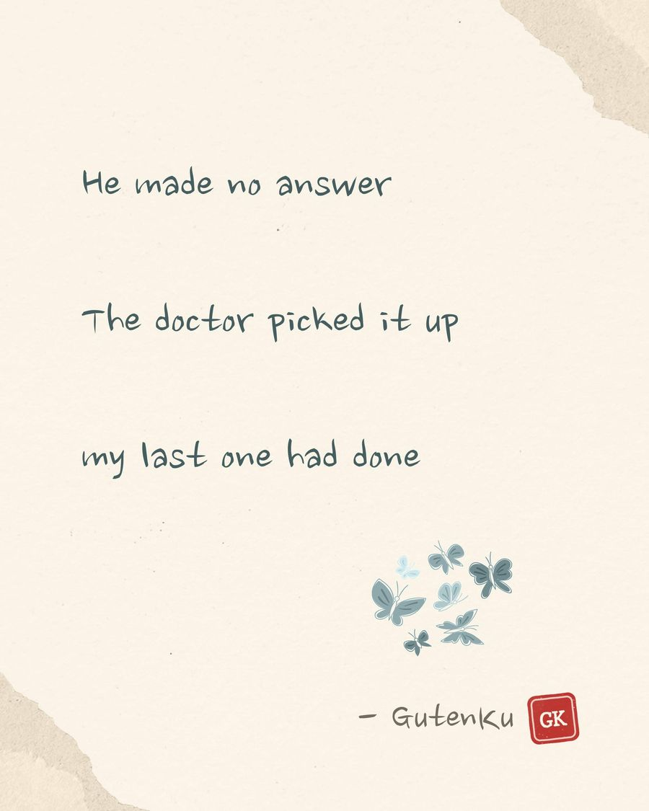

# GutenKu

<p align="center">
  
</p>

<p align="center">
  <em>Haiku poetry crafted from classic literature</em>
</p>

<p align="center">
  <a href="https://github.com/heristop/gutenku/actions/workflows/server.yaml"></a>
  <a href="https://github.com/heristop/gutenku/actions/workflows/front.yaml"></a>
  <a href="https://github.com/heristop/gutenku/blob/main/LICENSE"></a>
</p>

<p align="center">
  <a href="https://gutenku.xyz">gutenku.xyz</a>
</p>

<p align="center">🌸 · 🌸 · 🌸</p>

## Daily Haiku Card

<table>
<tr>
<td width="300" valign="top">

</td>
<td valign="top">

> _"This haiku suggests a moment of quiet grief and finality. The speaker says that someone "made no answer," creating a sense of silence, distance, or emotional withdrawal. The line about "The doctor picked it up" implies a medical setting, perhaps after an illness or death, and the object being picked up may symbolize something left behind or taken away. The final line, "my last one had done," hints that this was not the first such loss, but another in a series of painful experiences. The poem is brief, but it carries a deep feeling of sorrow, resignation, and the heaviness of repeated endings."_

— **BotenKu** 📅 _Nov 27, 2026_

</td>
</tr>
</table>

<p align="center">🌸 · 🌸 · 🌸</p>

## About

GutenKu transforms classic literature from Project Gutenberg into haiku poetry using NLP, Markov Chain algorithms, and OpenAI for selection and narrative generation.

## Features

- **AI-Powered Selection** — OpenAI refines haiku choices and generates poetic narratives
- **Self-Learning** — Neural network discovers quality patterns by observing which haiku survive evolution
- **Daily Puzzle Game** — Guess the source book from haiku clues
- **Shareable Cards** — Generate beautiful image cards for social media
- **Sentiment Analysis** — Score and filter haikus by emotional tone

## How It Works

1. **Scrape** — Collect texts from a curated whitelist of eBooks on Project Gutenberg
2. **Process** — Apply Markov Chain to sequence sentences with highest transition probabilities
3. **Structure** — Enforce traditional 5-7-5 syllable structure via NLP
4. **Evolve** — Genetic algorithm optimizes haiku through natural selection; a neural network learns which patterns survive
5. **Select** — Choose candidates and generate narratives with OpenAI
6. **Render** — Create shareable image cards

## Quick Start

```bash
git clone https://github.com/heristop/gutenku.git
cd gutenku
make install
make build
make dev
```

Run `make help` for all available commands.

## Tech Stack

| Package                              | Technologies                                        |
| ------------------------------------ | --------------------------------------------------- |
| [Server](/packages/server/README.md) | TypeScript, GraphQL, Apollo Server, MongoDB, OpenAI |
| [Front](/packages/front/README.md)   | TypeScript, Vue 3, Pinia, URQL, Cypress             |

## Acknowledgments

Thanks to the creators and maintainers of [Project Gutenberg](https://www.gutenberg.org/) for providing the texts.

## License

This project is licensed under the GPL-3.0 License - see the [LICENSE](LICENSE) file for details.

## Trademarks

GutenKu™ and GutenGuess™ are trademarks claimed by [heristop](https://github.com/heristop).
See [TRADEMARK.md](TRADEMARK.md) for branding and attribution guidelines.

<p align="center">🌸 · 🌸 · 🌸</p>

<p align="center">
  © 2023-2026 heristop / <a href="https://instagram.com/gutenku.poem">@gutenku.poem</a>
</p>
